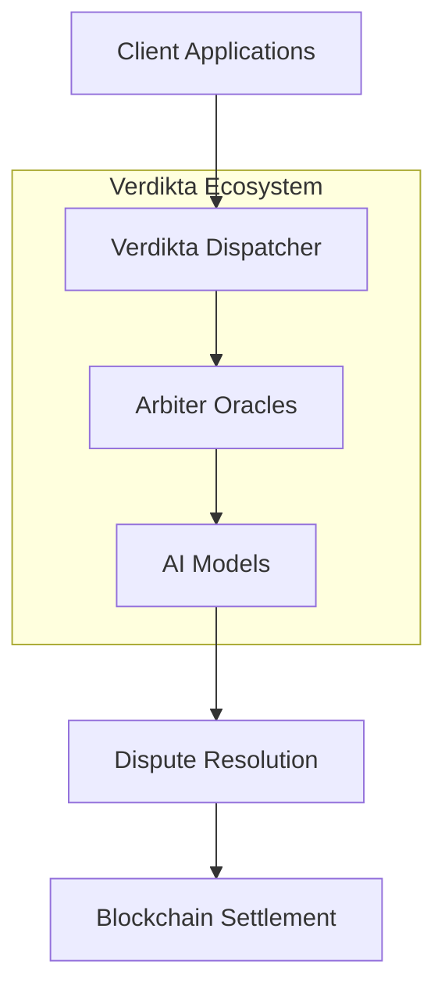

# Verdikta Documentation

Welcome to the comprehensive documentation for the Verdikta ecosystem - a decentralized AI-powered dispute resolution platform built on blockchain technology.

## What is Verdikta?

Verdikta is a decentralized oracle system that provides AI-powered dispute resolution services on blockchain networks. Our ecosystem combines advanced AI models with blockchain infrastructure to deliver fair, transparent, and efficient arbitration services.

## Quick Navigation

-   :fontawesome-solid-rocket:{ .lg .middle } **Node Operators**

    ---

    Set up and manage Verdikta Arbiter Nodes for dispute resolution

    [:octicons-arrow-right-24: Node Setup Guide](verdikta-arbiter-node-installation-guide/index.md)

-   :fontawesome-solid-code:{ .lg .middle } **Developers**

    ---

    Build applications using Verdikta's APIs and SDKs

    [:octicons-arrow-right-24: Developer Guide](apps/index.md)

-   :fontawesome-solid-file-contract:{ .lg .middle } **Smart Contracts**

    ---

    Integrate with Verdikta's on-chain components

    [:octicons-arrow-right-24: Contract Docs](verdikta-dispatcher-smart-contracts/index.md)

-   :fontawesome-solid-puzzle-piece:{ .lg .middle } **Integrations**

    ---

    Common utilities and integration patterns

    [:octicons-arrow-right-24: Integration Guide](verdikta-common/index.md)

## Architecture Overview

## Getting Started

Choose your path based on your role:

- **Node Operators**: Start with [Prerequisites](verdikta-arbiter-node-installation-guide/prerequisites.md) then follow our [Quick Start Guide](verdikta-arbiter-node-installation-guide/quick-start.md)
- **Developers**: Jump into our [Developer Quick Start](apps/index.md)
- **Smart Contract Developers**: Review our [Contract Overview](verdikta-dispatcher-smart-contracts/index.md)

## Key Features

- **🤖 AI-Powered**: Advanced language models analyze disputes and evidence
- **⚡ Fast Resolution**: Automated decision-making reduces resolution time
- **🔗 Blockchain Native**: Built on Base/Ethereum with smart contract integration
- **🌐 Decentralized**: Multiple independent arbiters ensure fairness
- **💰 Cost-Effective**: Significantly cheaper than traditional arbitration
- **🔍 Transparent**: All decisions are recorded on-chain with justifications

## Network Status

| Component | Status | Network |
|-----------|--------|---------|
| Arbiter Nodes | Beta | Base Sepolia |
| Dispatcher Contracts | Beta | Base Sepolia |
| Client SDKs | Alpha | - |
| Mainnet Launch | Planned | Base Mainnet |

## Support & Community

- **GitHub**: [Report issues and contribute](https://github.com/verdikta)
- **Documentation**: Browse our comprehensive guides
- **Discord**: [Join our community for support](https://discord.gg/verdikta)
- **Email**: [support@verdikta.org](mailto:support@verdikta.org) for direct assistance

---

!!! info "Beta Notice"
    Verdikta is currently in beta testing on Base Sepolia testnet. Features and APIs may change before mainnet launch.

!!! note "Protocol v2 (in development, not deployed yet)"
    Verdikta v2 is a breaking redeploy of the dispatcher contracts: one aggregator serves every jury size, the
    requester sets the jury (K drawn, M promoted, N counted, P clustered, and a timeout) with each request, the jury
    is drawn after the request from a block hash (optionally mixed with jury beacons), commits are bound to the
    round, arbiters answer hash-chain health calls, and a requester may set a fee floor. Every arbiter registers
    again with a stake. The v2 addresses will be published at the v2 deployment; the addresses in use today are v1.
    See the [overview](overview/index.md), the [architecture](overview/architecture.md) and the
    [changelog](changelog/index.md).