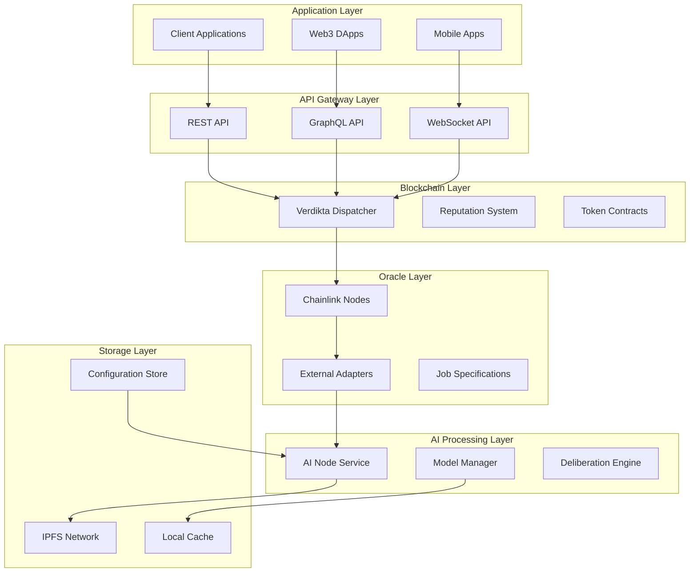
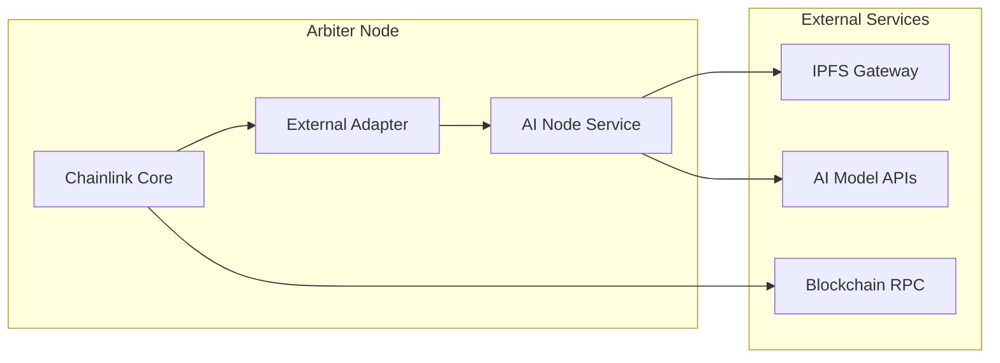
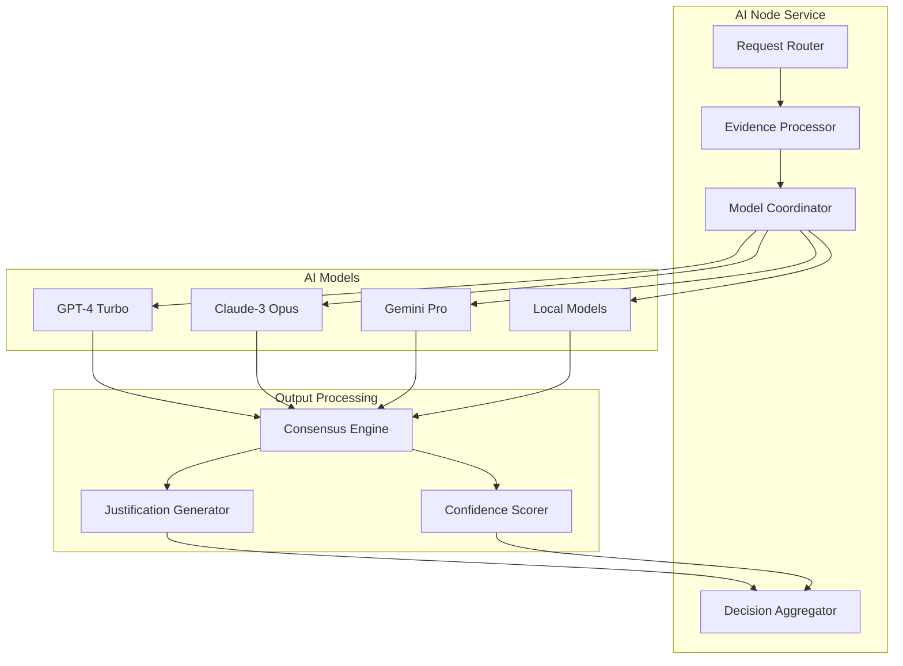
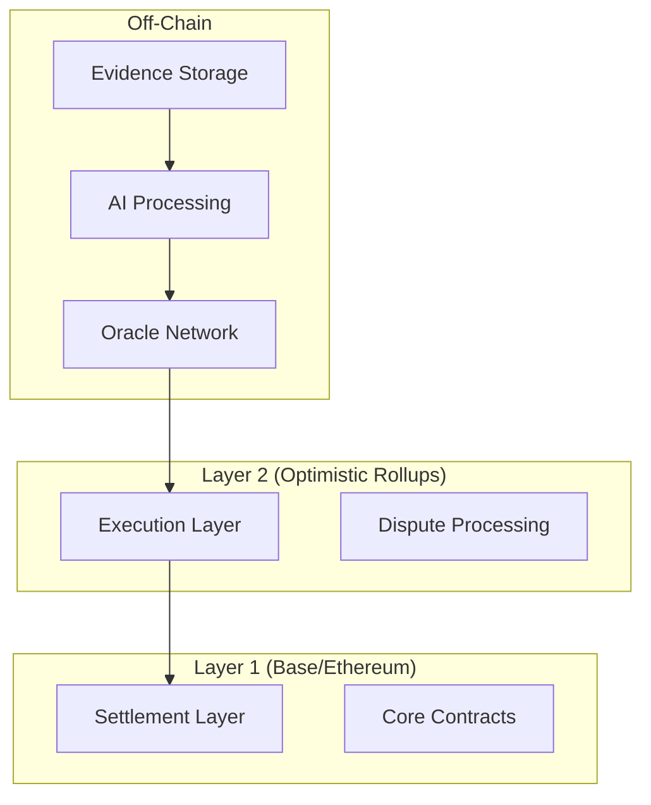

# Technical Architecture

## System Architecture Overview

Verdikta implements a layered architecture that separates concerns and ensures scalability, security, and maintainability.



## Component Details

### 1. Verdikta Dispatcher (Smart Contracts)

The core blockchain component that manages the entire dispute resolution lifecycle. This section describes
v2, a breaking redeploy of v1 that is not deployed yet: its addresses will be published at the v2
deployment. The contract pages under Smart Contracts give the full interfaces.

#### Key Contracts

- **`ReputationAggregator.sol`**: Takes requests and escrows their fees in ETH, draws each request's jury
  through the keeper, runs the commit and reveal phases over Chainlink operator requests, clusters the
  reveals, pays arbiters, and settles each round's reputation outcomes with the keeper. One deployment
  serves every jury size: each request carries its own jury.
- **`ReputationKeeper.sol`**: The arbiter registry. Stake (wVDKA), unbonding, the two reputation scores
  (quality and timeliness), blocks and bans, hash-chain health calls and the freeze, and
  reputation-weighted selection read as of the request block.
- **`JuryBeacons.sol`**: Optional per request. Picks beacon arbiters through the keeper and mixes their
  hash-chain values into the jury seed.
- **`ScoringLib.sol`**, **`AggregatorLib.sol`**: External libraries for clustering, quality classes and the
  promotion draw, and for payloads, the CID/salt parser and jury checks.
- **`ArbiterOperator.sol`**: Each arbiter's Chainlink operator. It accepts requests only from contracts the
  keeper approves (`isContractApproved`).

#### Aggregator and Keeper Functions

```solidity
// ReputationAggregator: a round
struct Jury { uint8 K; uint8 M; uint8 N; uint8 P; uint40 timeout; } // drawn, promoted, counted, clustered; seconds from the draw
function maxTotalFee(uint256 maxFee, uint256 minFee, bool withBeacons, uint8 K, uint8 P) view returns (uint256)
function requestAIEvaluationWithApproval(string[] cids, string addendumText, uint256 alpha, uint256 maxFee,
    uint256 minFee, uint256 estimatedBaseCost, uint256 maxFeeBasedScalingFactor, uint64 requestedClass,
    bool withBeacons, Jury jury) payable returns (bytes32 aggId)
function drawJury(bytes32 aggId)        // from block B+2; with beacons, call it again once the beacon values are in
function closeCommits(bytes32 aggId)    // after T+ with at least M commits, if no later commit closed the phase
function promote(bytes32 aggId)         // from block C+2 after the close: draws the M arbiters that reveal
function settle(bytes32 aggId)          // after the round's deadline; new requests also settle due rounds
function cancelUnsealed(bytes32 aggId)  // a round that can no longer be drawn: prepay to the treasury
function getEvaluation(bytes32 aggId) view returns (uint256[] scores, string justifications, bool valid)
function getRoundInfo(bytes32 aggId) view returns (uint8 phase, ...)   // 1 draw ... 7 settled, 8 failed, 9 cancelled
function getJury(bytes32 aggId) view returns (uint8 K, uint8 M, uint8 N, uint8 P, uint40 timeout)
function withdrawEth()                  // fees, rewards and refunds are credited to ethOwed

// ReputationKeeper: an arbiter
function registerArbiter(address oracle, bytes32 jobId, uint64 fee, uint64[] classes, bytes32 chainHead)
function answerHealthCall(bytes32 key, bytes32 preimage)
function rotateChain(bytes32 key, bytes32 preimage, bytes32 newHead)
function healthState(bytes32 key) view returns (bool pending, uint256 sentAt, bytes32 head)
function setPaused(bytes32 key, bool paused)
function requestExit(bytes32 key)       // stops selection at once
function completeExit(bytes32 key)      // after the unbonding period (2 days by default, never less): stake returned
function getArbiter(bytes32 key) view returns (ArbiterView)
```

A request is checked per request and reverts with `BadJury` unless K >= M >= N >= P >= 1, N <= 40,
P >= 2 unless N = 1, K <= `maxJury()` (default 50) and the keeper's `shortlistSize()` (60), and
`tPlus()` (155 s) < timeout <= `maxTimeout()` (3,600 s).

### 2. Arbiter Oracle Network

Chainlink-based oracles enhanced with AI capabilities for dispute processing.

#### Architecture Components



#### Job Specifications

Each arbiter runs two Chainlink jobs (templates in the arbiter repository: `chainlink-node/basicJobSpec` and
`chainlink-node/healthJobSpec`).

- **The request job** (`directrequest`) answers the aggregator's operator requests. The request's `cid`
  field says which phase it is:
    - **Commit**, `1:<cids>[:addendum]`: the node evaluates the query and answers with one word, its commit
      `keccak256(abi.encode(aggId, operator, response, salt))` in full, where `aggId` is the request's
      `aggId` as `bytes32`, `operator` the operator contract that fulfills, `response` the `uint256[]` it will
      reveal, and `salt` 16 random bytes, fresh for every commit.
    - **Reveal**, `2:<64 lowercase hex>`: the full commit hash. The node answers with the stored `response`
      and the CID `<justification CID>:<32 hex salt>`.
  The callback is `fulfill(bytes32, uint256[], string)` on the aggregator. The finalizing reveal pays for
  the clustering, so the job's gas limit is 9M.
- **The health job** (`cron`, every 10 s) reads `healthState(key)` from the keeper. While a health call is
  pending it asks the external adapter for the next value of the arbiter's hash chain and sends
  `rotateChain(key, preimage, newHead)` (with `newHead == preimage` that is `answerHealthCall`). An arbiter
  that leaves a call unanswered for `callDeadline` (60 s) is frozen, and not selected, until it answers.

### 3. AI Processing Engine

The core AI component that analyzes disputes and generates decisions.

#### Multi-Model Architecture



#### Model Weighting Algorithm

```typescript
interface ModelResponse {
  decision: 'plaintiff' | 'defendant' | 'split';
  confidence: number;
  reasoning: string;
  modelId: string;
}

interface ModelWeight {
  modelId: string;
  baseWeight: number;
  specialtyWeight: number;
  reputationScore: number;
}

function calculateFinalDecision(
  responses: ModelResponse[],
  weights: ModelWeight[]
): Decision {
  const weightedVotes = responses.map(response => {
    const weight = weights.find(w => w.modelId === response.modelId);
    const totalWeight = weight.baseWeight * weight.specialtyWeight * weight.reputationScore;
    
    return {
      ...response,
      weight: totalWeight * response.confidence
    };
  });
  
  // Aggregate weighted votes
  const votes = {
    plaintiff: 0,
    defendant: 0,
    split: 0
  };
  
  weightedVotes.forEach(vote => {
    votes[vote.decision] += vote.weight;
  });
  
  // Return decision with highest weighted score
  const winner = Object.keys(votes).reduce((a, b) => 
    votes[a] > votes[b] ? a : b
  );
  
  return {
    decision: winner,
    confidence: Math.max(...Object.values(votes)) / Object.values(votes).reduce((a, b) => a + b),
    justification: generateJustification(weightedVotes, winner)
  };
}
```

### 4. Data Flow

#### Dispute Processing Pipeline

1. **Initiation**
   ```
   Client → requestAIEvaluationWithApproval (block B: escrow, jury, query) → RequestAIEvaluation
   ```

2. **Jury Draw**
   ```
   Anyone → drawJury (from B+2; seed from blockhash(B+1)) → Keeper selection as of B → commit requests
   ```

3. **Evidence Retrieval**
   ```
   External Adapter → IPFS → Evidence Package
   ```

4. **AI Processing and Commit**
   ```
   AI Node → Multiple Models → Answer → commit hash → fulfill
   ```

5. **Promotion and Reveal**
   ```
   M+ commits (or T+ with M) → close at block C → promote (from C+2) → M reveal requests → N-th reveal finalizes
   ```

6. **Resolution Execution and Settlement**
   ```
   FulfillAIEvaluation → client reads getEvaluation → after the deadline, settle → keeper scores
   ```

#### Round Lifecycle (v2)

`getRoundInfo(aggId)` returns the round's phase:

| Phase | Name | What moves it on |
|---|---|---|
| 1 | draw | `drawJury` from block B+2. The requester earns the draw reward (2 × the fee ceiling) if it draws within 30 s; after that, whoever draws earns it |
| 2 | beacons | Only with `withBeacons`: the first `drawJury` picks 4 beacon arbiters, and a second `drawJury` draws the jury once 2 beacon values are in (within 120 s) |
| 3 | commit | The phase closes at the M+-th commit (M+ = M + ceil((K − M) / 2)), or with `closeCommits` once T+ (155 s) has passed since the draw with at least M commits |
| 4 | closing | `promote` from block C+2 draws M of all commits uniformly at random and sends them reveal requests. Its caller earns 1 × the fee ceiling |
| 5 | reveal | The N-th counted reveal finalizes. Promoted arbiters always get at least 120 s after `promote` |
| 6 | final | The result is readable (`getEvaluation`). Late reveals are still accepted and scored until the deadline. `settle` after the deadline |
| 7 | settled | Done |
| 8 | failed | No result; settled |
| 9 | cancelled | `cancelUnsealed`: the seed was never sealed within the block-hash history, or the round was not drawn within a day. The prepay goes to the treasury |

The round's `timeout` runs from the draw, not from the request. A round never times out before it is drawn,
but `drawJury` reverts with `DrawExpired` more than a day after the request.

#### Fees

- The requester escrows `maxTotalFee(maxFee, minFee, withBeacons, K, P)` in ETH (from `msg.value`, topped up
  from its `ethOwed` credit): `max(eff, minFee) × (K + B × P [+ 2 beacons]) + eff × (2 + 1)`, where
  `eff = min(maxFee, maxOracleFee())` is the fee ceiling, `minFee` the requester's fee floor (0 = none) and
  B the bonus multiplier (3).
- Each drawn juror's operator owner is credited its fee at the draw: `max(posted fee, minFee)`. Each arbiter in
  the cluster is credited B times that as a bonus. Eligibility uses the ceiling only, so the floor may exceed it.
- What is not spent returns to the requester's credit at finalization, or at settlement for a failed round.
  Where a refund would be a free re-roll, it goes to the treasury instead: a missed beacon quorum, a commit phase
  that had M commits but was never promoted, and a cancelled round.
- Everyone withdraws with `withdrawEth()`.

## Security Architecture

### Commitments Bound to the Round

```solidity
// the arbiter's commit, sent in full as the commit word
bytes32 commit = keccak256(abi.encode(aggId, operator, response, salt));   // salt: 128 bits, fresh per commit

// the reveal carries response and "<justification CID>:<32 hex salt>"; the aggregator recomputes the hash
// with msg.sender as the operator, and ignores a reveal that does not match
```

Including `aggId` makes a hash collision useful for one round only, and the full 32 bytes put one out of
reach. A malformed reveal still uses up the request, so there is no retry.

### Unpredictable Juries

- The jury is drawn from the keeper's state as of the request block B, seeded by `blockhash(B+1)`, so nobody
  can predict it when the request is signed, and who draws or when changes nothing.
- With beacons, the seed also mixes the first 2 beacon values, each fixed by the end of block B+1.
- The arbiters that reveal are drawn from all commits with `blockhash(C+1)`, so the arbiter that closes the
  commit phase cannot predict them, and committing first earns nothing.
- Cluster ties go by a seeded order of the slots, not by reveal order.

### Economic Security

- **Staking Requirements**: Each arbiter stakes `stakeRequirement()` wVDKA (100 by default) at
  `registerArbiter`; it is returned by `completeExit`, at least 2 days after `requestExit`
- **Reputation System**: Quality (+20 close to the median, −50 off, −200 far) and timeliness (+20 per delivered
  reveal, −200 for a promoted arbiter that did not reveal, −500 if that round failed, −400 for a
  non-committer in a round that failed for lack of commits). Scores run 0 to 1,000 and start at 500
- **Blocks and Bans**: A score that reaches 0 blocks the arbiter for 24 hours × 2^offenses and restarts it at
  500. The third offense is a permanent ban. One offense is forgiven per 90 clean days
- **Burns**: The keeper can burn stake on a block and on a ban; both are off by default
- **Liveness**: Unanswered health calls freeze an arbiter; a frozen arbiter is not selected

## Scalability Solutions

### Layer 2 Integration



### Performance Optimization

- **Parallel Processing**: Multiple disputes processed simultaneously
- **Caching Layer**: Frequently accessed data cached locally
- **Load Balancing**: Requests distributed across multiple AI nodes
- **Batch Operations**: Multiple operations bundled for efficiency

## Monitoring & Observability

### Key Metrics

- **Dispute Resolution Time**: Average time from submission to resolution
- **Oracle Response Time**: Time for oracles to process requests
- **AI Model Performance**: Accuracy and confidence scores
- **Network Utilization**: Resource usage across components
- **Economic Metrics**: Fees, rewards, and stake utilization

### Health Checks

```typescript
interface HealthCheck {
  component: string;
  status: 'healthy' | 'degraded' | 'unhealthy';
  lastChecked: Date;
  metrics: Record<string, number>;
}

const healthChecks = {
  blockchain: checkBlockchainHealth,
  oracles: checkOracleHealth,
  aiService: checkAIServiceHealth,
  ipfs: checkIPFSHealth
};
```

This technical architecture ensures Verdikta can scale to handle thousands of disputes while maintaining security, decentralization, and reliability. 