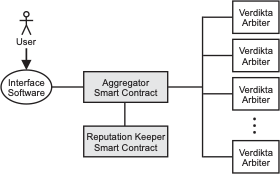

# Verdikta: Trustless Automated Decisions

*Verdikta whitepaper, 2026. Revised in November 2026 to describe the contracts as deployed on Base. Figures that the contracts' owner can change are given as they stood on 22 November 2026.*

!!! info "One whitepaper, two places"
    This page carries the same text as the whitepaper on the website, [www.verdikta.org/whitepaper](https://www.verdikta.org/whitepaper), which also offers it as a [PDF](https://www.verdikta.org/whitepaper/verdikta-whitepaper.pdf). The statements that depend on the deployed contracts can be checked with `scripts/check-live-facts.mjs` in the [documentation repository](https://github.com/verdikta/verdikta-docs).

## Abstract

Blockchain-based smart contracts excel at enforcing objective rules but cannot resolve subjective disputes or interpret off-chain information on their own. Verdikta is a decentralized protocol that brings trustless artificial intelligence (AI) to blockchain applications. By leveraging multiple independent AI agents (called arbiters) and a commit-reveal scheme, Verdikta enables on-chain decisions for complex questions—such as contract disputes and content-moderation issues—without relying on any single trusted party. Arbiters stake the native token VDKA to participate, aligning their incentives with honest behavior. The system selects arbiters pseudorandomly (weighted by reputation) to evaluate each query, aggregates their responses via cryptographic protocols, and rewards consensus while penalizing outliers. The result is a secure oracle for subjective judgments: one that combines the speed and consistency of AI with the decentralization and incentivization of blockchain. Verdikta offers fast, low-cost, impartial decision making for the decentralized digital economy.

## 1. Introduction

Decentralized ledgers have enabled trustless transactions of digital value, but a gap remains when real-world disputes or subjective judgments are needed. Traditional dispute resolution—courts, arbitration, or human juries—is too slow, expensive, and jurisdictionally limited for the fast-moving global digital economy \[1\]. Early innovators in decentralized justice like Kleros demonstrated that crowdsourced jurors with crypto-economic incentives can serve as a decentralized arbitration service. But human-driven systems face scalability limits and cannot handle the volume and speed required for on-chain applications in real time.

At the same time, blockchains struggle to access or verify off-chain information, a challenge known as the oracle problem \[2\]. Any smart contract that depends on external data—a price feed, an IoT sensor reading, or the outcome of a legal dispute—must trust an oracle to deliver that data. Relying on a single source or entity reintroduces a centralized point of failure in an otherwise decentralized system. This problem extends to AI-based judgments: while an advanced AI model could analyze text and other media and provide an answer, a lone AI service becomes a trusted third party, undermining the trustless nature of the contract. And AI models are not infallible \[3\]. Errors and biases from a single AI can lead to incorrect or unfair outcomes.

Verdikta addresses these challenges by combining a decentralized oracle infrastructure with multiple AI agents and a robust incentive mechanism. Inspired by the success of networks like Chainlink in securing data feeds and by commit–reveal schemes to prevent oracle collusion \[4\], Verdikta creates an AI-powered oracle network where no single arbiter's output is decisive. Each query posed to Verdikta is evaluated on demand in parallel by a committee of independent AI arbiters. The arbiters are randomly selected and do not know of each others' answers during evaluation, ensuring they work independently and honestly. The final answer emerges from an on-chain aggregation of multiple responses, with an algorithm designed to find consensus and filter out outliers. Arbiters whose answers align with the consensus are rewarded, while those who deviate or fail to respond are penalized, both financially and via reputation scores.

A cornerstone of Verdikta's design is its native token, VDKA. This token is staked by arbiters to qualify as service providers. By requiring ownership of some amount of VDKA, initially 100, to register an arbiter, Verdikta ensures participants stand to lose from dishonest conduct. Reputation scores tracking each arbiter's historical accuracy and responsiveness complement the stake, guiding the selection of arbiters for future tasks. This two-tiered approach—stake-based access and reputation-based selection—promotes a self-regulating ecosystem of arbiters.

Verdikta operates on blockchain networks (deployed initially on Base, with future multi-chain support) as a set of smart contracts that coordinate the entire process trustlessly. Verdikta's approach is a natural evolution of trends in the blockchain space: just as Bitcoin introduced a peer-to-peer currency \[5\] and Ethereum enabled self-enforcing agreements \[6\], Verdikta aspires to enable self-resolving agreements. By harnessing AI and cryptography, it offers a path to resolving disputes and answering subjective questions in a manner that is efficient, impartial, and not beholden to a central authority. The implications extend beyond any single project—Verdikta is part of a broader movement towards autonomous, trust-minimized decision-making in decentralized systems, signaling hope for fair and accessible justice in the digital era.

## 2. System Overview

Verdikta is composed of on-chain smart contracts and off-chain AI oracle nodes working in tandem to produce a transformative result. The figure below illustrates the conceptual architecture:

**Users (Requesters):** Any Ethereum-based application or user can act as a requester by submitting a query to Verdikta at any time (an important aspect of the process \[7\]). A query can be a dispute to resolve, a piece of content to evaluate, or any question answerable by AI analysis. The query details (evidence, descriptions, etc.) are provided via the IPFS network as content-addressed data (ensuring immutability of evidence). The user also supplies a payment in ETH as a reward for the arbiters.

**Verdikta Aggregator Contract:** The on-chain heart of Verdikta is the Aggregator contract. When it receives a new request, it selects a committee of arbiters, sends out tasks (via Chainlink oracles) in a commit–reveal pattern, collects responses, and computes the final outcome. It holds the funds for payments and disburses them according to the outcome. The aggregator contract is also responsible for emitting events and storing results for later retrieval.

**Reputation Keeper Contract:** Supporting the aggregator is the ReputationKeeper contract. This module maintains the registry of arbiters, including their staked VDKA tokens and their reputation scores. It provides functionality for selecting arbiters pseudorandomly with weighting by reputation, and it updates scores after each query is resolved. The Reputation Keeper ensures that over time, reliable arbiters are chosen more often, while unreliable ones are sidelined or ejected.

**AI Arbiter Nodes:** Off-chain, multiple independent nodes run the Verdikta oracle software. Each arbiter node is essentially a Chainlink node (or similar oracle node) augmented with AI capabilities. An arbiter is identified by an on-chain address and a job ID, and must stake 100 VDKA tokens in the Reputation Keeper to be active (on Base, in the wrapped form wVDKA). These nodes listen for tasks from the aggregator contract. When selected for a query, an arbiter node fetches the query data from IPFS, runs the AI models that the query names (e.g., large language models from several providers) to evaluate the query, and prepares a response. Each arbiter's response consists of a set of numeric likelihood scores (for each possible outcome or category of the query) and a textual justification for its decision. The justification is stored on IPFS (yielding a CID) so that the on-chain network only needs to handle a short (approximately 50-character) reference, not large text.

**VDKA Token and Staking:** VDKA is the native ERC-20 utility token of Verdikta. Staking 100 VDKA is a prerequisite for becoming an arbiter, serving as a bond that can be locked or slashed if the arbiter performs poorly. The stake and reputation system together create sybil resistance (preventing a single entity from spinning up many low-quality arbiters) and economic trust: an arbiter with a large stake and a strong reputation stands to gain from honest work and lose from malicious behavior. The VDKA token also aligns the interests of governance participants and investors with the long-term health of the network, as it underpins the security of the dispute resolution process.

**Chainlink Oracle Network:** Verdikta leverages Chainlink to dispatch requests to arbiters and receive their responses. The commit–reveal scheme (detailed in the next section) is implemented using two rounds of oracle calls. By building on Chainlink, Verdikta benefits from a robust, time-tested infrastructure for connecting on-chain contracts with off-chain computation, while all fees and arbiter payments are made in ETH. It's important to note that Verdikta's design is blockchain-agnostic: while the initial deployment is on Base (an Ethereum Layer-2), the same contracts and oracle processes can be implemented on other EVM-compatible chains or rollups, allowing Verdikta to expand its decentralized justice service wherever needed.

**Verdikta Workflow Summary:** A user submits a request to the Verdikta Aggregator (with IPFS CIDs and payment). The Aggregator consults the Reputation Keeper to randomly choose a set of arbiters (using a mix of on-chain randomness and entropy provided by arbiters, so the selection cannot be predicted or manipulated). The chosen arbiters first receive a commit request, and they must process the query then commit using an answer hash. After enough commitments are collected, a reveal request is sent to a subset of the arbiters to obtain the actual answers. The aggregator contract then aggregates the revealed answers to produce a final decision and records it on-chain, while rewarding the arbiters chosen to contribute to the final answer. Throughout this process, no trust is placed in any single arbiter: the combination of random selection, cryptographic commitments, and majority aggregation ensures that the system can tolerate faulty or even malicious participants, similar in spirit to Byzantine Fault Tolerant consensus.

In the following sections, we break down this process in detail, examining how each phase works and how Verdikta aligns the arbiters to behave correctly.

## 3. Commit–Reveal Evaluation Protocol

Verdikta employs a two-phase commit-reveal scheme for oracle responses, an established technique to prevent cheating by withholding or copying answers. The commit-reveal approach ensures that each arbiter must decide on an answer independently, without knowing the answers of others, before any answer is revealed publicly. This is crucial to avoid a lazy or malicious arbiter simply imitating others. The exchange of information in the Verdikta process is illustrated in the figure below:

**Phase 1: Commit Phase.** When a new request arrives, the aggregator contract generates a unique Aggregation ID (aggId) for the query and selects K arbiters for the commit phase. The parameter K is the number of arbiters polled initially (for example, K = 6 by default). The selection of these arbiters is pseudorandom and weighted: the Reputation Keeper uses a random seed (combining blockchain randomness with entropy from previous requests) to perform a weighted random draw from the pool of active arbiters. The weight for each arbiter is influenced by its reputation scores and fee bid, ensuring high-reputation and cost-efficient arbiters have higher chances. This mechanism balances quality and decentralization: it favors proven performers while still incorporating randomness so that less-established arbiters can be chosen and new entrants have a fair shot.

Once selected, each arbiter is sent a commit request. The request includes the query payload—a content identifier that encodes the question and any evidence. Each arbiter off-chain retrieves the query data (from IPFS using the provided CID), runs the specified AI analysis, and obtains a provisional result: a vector of numerical scores (e.g., likelihoods or confidence levels for each possible outcome) and a justification text. Instead of returning this result immediately, the arbiter creates a commitment. The commitment is a 128-bit hash representing the arbiter's answer, defined as:

commitHash = bytes16( SHA-256( \[sender, likelihoods, salt\] ) )

where likelihoods are the numerical scores and salt is a random 80-bit number chosen by the arbiter. The salt ensures that the commitment hash does not reveal any information about the actual answer (much like a voter sealing a ballot in an envelope, the hash "seals" the answer, making it unchangeable). The arbiter then submits this commit hash on-chain to the aggregator contract. An event CommitReceived is logged, recording that the commit for a given arbiter has arrived.

The commit phase continues until M commits are received, where M ≤ K is a threshold configured (e.g., M = 4 by default). In Verdikta's protocol, the first M arbiters who submit their commitments promptly will move on to the reveal phase. Once the aggregator contract has collected M distinct commit hashes, it emits a CommitPhaseComplete event and transitions to the next phase. Arbiters who were selected but did not submit a commit in time are considered to have failed the commit phase—they will be penalized in reputation for being unresponsive (more on penalties in section 5). If fewer than M commits have arrived when the timeout passes, anyone can call the aggregator's finalizeEvaluationTimeout function, which closes the request as failed, applies the penalties and credits the unspent part of the payment back to the user. There is no grace period: a single timeout, measured from the request, covers both phases. This ensures that a lack of response doesn't hang indefinitely—users will either get enough commits to proceed or have the query fail fast.

**Phase 2: Reveal Phase.** Once commit phase is complete, the aggregator contract initiates reveal requests to those M arbiters who committed. Each reveal request includes the original commitment hash as a reference. When an arbiter receives the reveal call, it knows it should now send the actual result. The arbiter responds by providing:

1. The list of likelihood scores (the same data that was hashed earlier).
2. The justification CID (pointing to the explanation text it uploaded to IPFS).
3. The random salt used in the commitment.

The aggregator contract, upon receiving a reveal response, first verifies the integrity of the data by recomputing the hash and checking that it matches the previously submitted commit hash for that arbiter. This commit–reveal validation guarantees that the arbiter did not change its answer between phases; if the hashes mismatch, the response is rejected and a RevealHashMismatch event is emitted, flagging a potential dishonest behavior.

With valid revealed data, the contract records the response. Each response is tagged with the arbiter's identifier and timestamp. As soon as the N-th valid reveal is received (where N is the minimum number of reveals required, e.g. N = 3), Verdikta proceeds to aggregate the results and finalize the outcome. The aggregation runs in the same transaction as the N-th valid reveal; a reveal that arrives after it is rejected, and its arbiter is treated as not having revealed. In practice, Verdikta's defaults (K=6, M=4, N=3) mean that out of 6 queried arbiters, at least 4 will commit and 3 need to reveal for a decision. This provides some redundancy: even if one or two arbiters drop out or malfunction, the system can still complete with the first 3 reveals.

It's worth highlighting the security properties achieved by this commit–reveal protocol:

**Freeloading prevention:** An arbiter cannot simply wait, see another's answer, and copy it, because no answers are revealed until the commitment stage is over. All chosen arbiters must commit blindly to their own computed result. By the time reveals happen, each arbiter's answer is already locked in (as an on-chain hash).

**Consistency and auditability:** The reveal hash check ensures consistency; an arbiter is cryptographically bound to the answer it committed. If an arbiter attempts to reveal a different answer (perhaps hoping to align with others after the fact), the hash mismatch will expose this. This is akin to proving one's vote in an election matches the earlier sealed vote, a technique also used in decentralized voting systems like UMA's oracle \[8\].

**Fair randomness:** The selection of arbiters for the commit phase uses an entropy mixture such that neither the arbiters nor the requester can easily game who gets selected. Verdikta's entropy includes unpredictable factors like previous block hashes and contributions from arbiters themselves (each arbiter's salt from reveals is folded into a rolling entropy pool). This design means the set of arbiters for each query is essentially random and unknowable in advance, which helps prevent targeted collusion or bribery attempts.

By the end of the reveal phase, the aggregator contract holds up to N responses (each with scores and justifications). Next, the protocol must combine these individual answers into a single authoritative result for the query. We discuss this aggregation step in the following section.

## 4. Aggregation and Decision Output

The core promise of Verdikta is that the final output reflects a consensus of multiple AI judgments, rather than the whim of a single oracle. Achieving this requires an aggregation algorithm that can distill multiple inputs into one output while filtering out any anomalies or lies. Verdikta's aggregation procedure is designed to reward the emergence of a cluster of agreeing responses and to diminish the influence of outliers.

Once the required N responses are in, the aggregator contract marks the evaluation as complete. It then performs the following steps:

**Selecting the Consensus Cluster:** Out of the responses received, Verdikta looks for a subset of size P (P is a parameter, default P = 2) that constitutes the best matching cluster. In practice with N=3 and P=2, this means finding the two responses that are most similar to each other (leaving the third one aside if it significantly differs). Similarity is measured by the distance between the likelihood score vectors. Verdikta uses a simple Euclidean distance metric: for any two responses A and B with score vectors (a₁,...,aₘ) and (b₁,...,bₘ) (for m outcome options), the distance d(A,B) is computed as √(Σᵢ₌₁ᵐ (aᵢ - bᵢ)²). The pair of responses with the smallest distance (i.e. highest agreement) is chosen as the cluster. This method effectively identifies a consensus even if one arbiter disagrees; the disagreeing one will be an outlier with a larger distance from the others and thus excluded from the best cluster.

For example, suppose three arbiters return percentage scores on a query with two possible outcomes (Yes/No):

- Arbiter1: [80%, 20%]
- Arbiter2: [90%, 10%]
- Arbiter3: [50%, 50%]

Here Arbiters 1 and 2 are quite close (both leaning strongly "Yes"), whereas Arbiter3 deviates. The distance between 1 and 2 is small, while 3 is far from either. Verdikta would cluster Arbiter1 and Arbiter2 as the consensus group (size P=2). If more than P responses were obtained and multiple clusters were possible, the algorithm can be generalized to find the largest group of responses that are mutually close; but with the default P=2, it essentially picks the closest pair as the nucleus of the consensus.

**Averaging the Results:** Having determined which responses fall in the consensus cluster (marked internally with cluster = 1 for those responses), the aggregator computes the final aggregated likelihoods. This is done by a simple component-wise average of the scores in the cluster. In the above example, the final Verdikta result would average Arbiter1 and Arbiter2's outputs: yielding \[85%, 15%\] as the outcome. If the cluster had more members or different values, all those in the cluster would be averaged. By averaging, Verdikta smooths out any minor differences between agreeing arbiters and arrives at a representative figure. This number can be interpreted as the "verdict" of the decentralized AI panel. In many cases, it could be a binary decision encoded as a probability or confidence level (e.g., a score above 50% means a decision in favor of one party). It could also represent a rating or classification (for example, content is deemed 90% likely to be acceptable under policy). The exact interpretation is up to the application using Verdikta, but in all cases the score is derived from multiple independent evaluations, making it more robust than any single evaluation.

**Combining Justifications:** Verdikta not only provides a numeric answer but also qualitative justification. Each arbiter in the cluster has submitted a justification CID pointing to an explanation (a text document outlining the reasoning). To maintain transparency, Verdikta aggregates these by concatenating the justifications from the cluster members. The result is a single string formed by the CIDs separated by commas that is recorded on-chain. For instance, if two arbiters in the cluster provided justifications stored at IPFS hashes QmX...abc and QmY...def, the contract will output a combined justification field like "QmX...abc,QmY...def". This allows users or other contracts to retrieve all relevant explanations. These justifications are crucial for user trust: anyone can inspect the reasoning behind the verdict, which is especially important for subjective matters. If both justifications independently point to the same evidence or logic, one gains confidence that the decision was well-founded. If they differ, one can get a multi-perspective view. The justifications live off-chain (to save gas costs) but are permanently linked to the on-chain verdict via content hashes.

**Finalization:** The aggregator contract marks the request as completed and emits a FulfillAIEvaluation event, which includes the aggregation ID, the final aggregated scores, and the combined justification CIDs. This event (and the contract's state) now hold the official outcome. The user or any interested party can call the contract's view function getEvaluation(aggId) to fetch the numeric result and justifications. Other smart contracts can also use the result trustlessly; for example, a decentralized escrow contract could release funds to a winner if Verdikta's result for a dispute query indicates a certain outcome. The result is available on-chain for such programmatic consumption, while the human-readable rationale is available off-chain via IPFS.

It is important to note that if the reveal phase timed out without reaching N responses, Verdikta would not aggregate partial data. Instead, once the timeout function is called, it would treat the evaluation as failed and emit an EvaluationFailed event. In such cases, the user might choose to resubmit the query or fall back to another mechanism. However, with properly incentivized arbiters and a robust network, timeouts should be rare. The chosen parameters (like a 5-minute response timeout) balance giving arbiters enough time to run AI models with ensuring users get results in a reasonable time window.

By aggregating multiple AI outputs, Verdikta not only mitigates the risk of any single point of failure, but also tends to produce more accurate and unbiased decisions. This approach resonates with the concept of the "wisdom of crowds" (or in this case, wisdom of AIs): just as averaging the judgments of many can cancel out individual errors, combining multiple AI perspectives can reduce the bias or noise present in one model. Recent research and prototypes (e.g., Oraichain's Modestus content oracle \[9\]) have shown that ensembling diverse models can yield more balanced results. Verdikta operationalizes this insight in a decentralized setting. By design, it expects honest arbiters with access to potentially different AI models or data sources, so that their independent approaches collectively converge on truth.

With the decision made and recorded, we now turn to how Verdikta incentivizes the arbiters throughout this process. The next section details the reward and reputation scheme that underpins the integrity of the system.

## 5. Incentives and Reputation

Verdikta's security and reliability emerge from a careful incentive structure. Each arbiter is economically motivated to supply honest, timely, high-quality answers. This is achieved through a combination of monetary rewards, token staking requirements, and reputation scoring that affects future earnings. Here we explain how arbiters are paid and scored, and how the VDKA staking mechanism ties into these incentives.

**Payment of Fees and Bonuses:** When a user submits a request, a maximum fee per oracle (in ETH) is specified, and the user sends with the request enough ETH to cover the worst case at that maximum: the maximum times (K + B × P), which is twelve times the maximum with the defaults. Only arbiters whose registered fee is at or below the maximum can be selected. Each arbiter selected for the commit phase is paid its own registered fee as a base fee: the contract credits it to the owner of the arbiter's operator contract at the moment the request is dispatched, before any work is done, so that nothing can be gained by submitting a fake commit. Payments are credits in the aggregator's ledger, which the recipients withdraw. This up-front payment covers the oracle's work and costs (e.g., computation, API calls). However, Verdikta introduces a further incentive: an additional bonus with multiplier B (default B = 3) for those arbiters whose answers end up in the consensus cluster. In other words, if an arbiter's result was part of the final aggregated outcome, that arbiter earns an additional B× their base fee as a bonus, paid out at the end of the evaluation. By default, with B=3, a clustered arbiter earns 1 (base) + 3 (bonus) = 4× the fee of a non-clustered arbiter. This creates a strong financial motive to be both correct and among the fastest responders (since only the first N responses are considered).

Consider the outcome categories for arbiters in one request:

**Cluster Winner:** The arbiter committed and revealed on time, and its answer was part of the consensus cluster that determined the outcome. Reward: 4× fee (base + bonus); Reputation: gains in both accuracy and timeliness (as described below).

**Participant (Non-Clustered):** The arbiter committed and revealed on time (so it did the work), and its answer was among the first N but outside the final cluster. Reward: 1× fee (base only, no bonus); Reputation: will incur an accuracy penalty but no timeliness penalty.

**No-Show / Dropout:** The arbiter was selected but either failed to commit or committed but failed to reveal in time. This includes an arbiter whose commit or reveal arrived after the M commits or N reveals the round needed. Reward: 1× fee (base only, no bonus), but such behavior is punished through reputation and potentially stake. Reputation: a negative mark on timeliness.

All bonus payments are handled by the aggregator contract at finalization. The bonus is taken from the ETH the user sent with the request, which was sized to accommodate worst-case bonus payouts; whatever a round does not spend is credited back to the user, who can withdraw it or let it fund a later request. The deployed contract has no other source of funds: every request is paid for by its requester. In any event, the protocol ensures that arbiters who contribute to the correct outcome earn substantially more, whereas those who lag or misreport gain little and will gradually be pushed out.

**Reputation Scores:** Verdikta tracks two separate reputation metrics for each arbiter:

**Quality Score (Accuracy):** This reflects how often the arbiter's answers have aligned with the eventual consensus. Each arbiter's answer is essentially "validated" by whether it was in the majority cluster or not. Verdikta quantifies this by adjusting a quality score. For a clustered winner, the quality score increases (e.g., +60 points). For an arbiter that gave a revealed answer but was not in the cluster (meaning it disagreed or gave a divergent result), the quality score decreases (e.g., –60 points). If an arbiter failed to reveal, that also implies no contribution to a correct answer, but the penalty for that is accounted under timeliness. Quality score captures the accuracy or consensus adherence of an arbiter's outputs.

**Timeliness Score:** This reflects reliability and participation rate. Arbiters who respond within deadlines and complete tasks get rewarded on timeliness; those that time out or skip phases get penalized. Verdikta's default scoring grants a +60 timeliness for successfully completing a commit–reveal cycle on time and clustering, while failing to reveal earns -20 and failing to commit incurs a –20 timeliness penalty. Timeliness is important because even an accurate arbiter is not useful if it doesn't answer when needed.

These scores are maintained in the Reputation Keeper contract. Every time an evaluation finishes, the aggregator calls the Reputation Keeper's updateScores for each arbiter involved, with parameters indicating the outcome for that arbiter (clustered, participated, or failed). Over time, each arbiter ends up with a history that helps predict its future performance.

**Selection Weighting:** When new requests come in, the Reputation Keeper uses these scores to weight the random selection of arbiters. A simplified description of the formula for an arbiter's weight wᵢ is:

**wi = clamp(((1000 - α)Qi + αTi) / 1000, Wmin, Wmax) × clamp((Fmax - β) / (feei - β), 1, Smax)**

where Qᵢ and Tᵢ are the quality and timeliness scores, α is a tunable parameter (0–1000) favoring quality vs. timeliness, and the second factor is a fee-based weight that favors lower-fee oracles (with β a base cost and *Fmax* a max fee limit). *Wmin* and *Wmax* are clamping parameters set in the contract (60 and 6000 at present), and *Smax* is set by the user with each request. When more than 20 arbiters are eligible, 20 of them are first drawn at random and the weighted draw is made among those. In essence, higher reputation yields a higher chance of selection, and asking for a higher fee lowers an arbiter's chance. The weight is capped between certain bounds to avoid any single arbiter dominating or being completely excluded. The result of this weighted random selection is that reputable, cost-efficient arbiters get picked more often, earning more fees over time, while low performers and those charging high fees find themselves rarely chosen (and earning less until they improve).

**Staking and Slashing:** The 100 VDKA stake per arbiter is a collateral that can be impacted by persistent poor performance. Verdikta defines threshold levels for scores:

If an arbiter's quality or timeliness score drops below a mild threshold (–300 points at present), its stake is locked for a period (24 hours at present): it cannot deregister and withdraw its stake, although it can still be selected. This serves as a warning without loss of funds, allowing the operator to re-evaluate and perhaps fix issues.

If a score drops below a severe threshold (–900 at present), the arbiter is locked and also excluded from selection for that period, the failing score is reset to the mild threshold, and a slashing can occur: a configured amount of its staked VDKA is forfeited. On Base mainnet that amount is set to zero at the time of writing, so no stake is taken today; the mechanism exists and the contract's owner can set the amount. Where an amount is set, the threat of losing stake is a deterrent against deliberate misbehavior or repeated negligence.

Additionally, Verdikta monitors a rolling window of performance. If an arbiter shows a persistent decline in performance metrics over a number of recent tasks (e.g., consistently being an outlier or timing out), the system takes action to levy penalties.

Through staking, Verdikta is designed to provide economic security similar to proof-of-stake consensus: an attacker who wanted to consistently corrupt the oracle's outputs would have to sacrifice stake as their quality plummets and slashing triggers. With the slash amount at zero, as it is today, what such an attacker loses is the arbiters' reputation, their selection and the income that goes with them. Moreover, the requirement of staking 100 VDKA per arbiter means there is a capital cost to populating the network with Sybil identities. An adversary attempting to control a large fraction of arbiters must acquire and lock a proportionally large amount of VDKA tokens, which economically aligns them with the network's success (since attacking the system would devalue their own stake).

**Summary of Incentive Alignment:** An honest and capable arbiter in Verdikta stands to gain regular fees and bonus rewards, and will see its reputation grow, leading to even more selection opportunities. A dishonest or lazy arbiter will either be caught by the commit–reveal and consensus process (resulting in no bonus and a quality penalty) or will fail to respond (resulting in no bonus and a timeliness penalty). In either case, reputation drops, it gets selected less often, and it loses access to stake if poor performance continues. This creates a self-reinforcing cycle: good arbiters prosper and remain in the system, bad arbiters eventually exit (voluntarily or via slashing). Users can thus trust that over time the oracle network is composed of mostly competent and honest participants—much like how Bitcoin miners who consistently fail to mine valid blocks earn nothing and drop out, while good miners accumulate rewards.

The design also inherently tolerates faults: because multiple arbiters are involved in each query, even if one or two are malicious or unreliable, as long as a majority (e.g., 2 out of 3) are honest, the correct outcome will be decided by the cluster. Those honest arbiters get rewarded and the dishonest one is penalized, meaning the next time the odds of a majority honest committee are even higher. This mirrors the game-theoretic equilibrium seen in other decentralized protocols (Byzantine fault tolerance, majority voting with incentives), applied here to AI oracle outputs.

In addition to automatic incentives, governance plays a role. At the time of writing, the settings of both contracts (K, M, N and P, the bonus multiplier, the timeout, the fee ceiling, the score changes and thresholds, and the slash amount) are set by the owner address of each contract, the same address for both, and the contracts contain no voting. The intention is that holders of VDKA (which could include arbiters and users) come to have a say in how the Verdikta system evolves and progresses with new smart contracts and applications, so that the token not only secures the system but also carries a decentralized governance process. That process is not part of the deployed contracts today.

## 6. Security and Trust Analysis

Verdikta's protocol is constructed to maximize trustlessness, but as with any system bridging blockchains and AI, it's vital to analyze the assumptions and potential attack vectors. Here we consider the key security aspects:

**Decentralization and Collision Resistance:** Verdikta relies on decentralization at multiple levels. The design calls for arbiters that are numerous and independently operated, with no company or authority controlling a majority of them. How close the network is to that can be read from the chain: on 22 November 2026 the registry on Base mainnet held 40 arbiters under four operator contracts, which belonged to three owner addresses, one of them holding half of the arbiters. The random selection for each query means the composition of arbiters is unpredictable and typically different for each request. This decentralization ensures that there is no single point of failure or control. Even if one arbiter is compromised or biased, the probability that it will determine the outcome alone is low—others will provide checks and balances. The commit–reveal scheme further isolates arbiters' decision-making. Only if a majority of the selected arbiters collude and provide the same wrong answer would Verdikta be fooled. This is analogous to a 51% attack in Bitcoin or any majority-voting system: it's possible in theory but made economically irrational in practice. An attacker would have to control multiple arbiters (each with significant stake) and risk losing reputation and stake on all of them if discovered. Since arbiters do not know in advance which requests they'll be assigned to (thanks to randomness), it's hard for an attacker to even target a specific high-value query.

**Entropy and Manipulation Resistance:** The randomness used for selecting arbiters (and for arbiters' own commit salts) is important. Verdikta uses a combination of on-chain randomness (e.g., Ethereum's prevrandao) and unpredictable input from arbiters (their salts, which are revealed only after commits). By updating a rolling entropy value with each request's salt and the previous block hash, Verdikta ensures each selection seed is fresh and not foreseeable. This prevents a malicious actor from pre-computing which arbiter addresses might get picked and targeting them. It also thwarts any attempt by an arbiter to choose a salt to bias the randomness (since each arbiter's influence on entropy is combined with others). In essence, Verdikta treats the commit salt as not only a privacy measure but also as a source of collective randomness, strengthening the unpredictability of future selections.

**Free-rider and Copy Protection:** We touched on this earlier—commit-reveal is specifically there to prevent an oracle from copying another's answer. This deserves emphasis because one might wonder: if arbiters get paid regardless, why wouldn't a lazy one just wait for someone else to do the work and copy them? Verdikta neutralizes that strategy. During the commit phase, every arbiter must submit a hash of their answer. If they wait and do nothing, they won't have a valid commit when the phase ends and will be disqualified. If they submit a random commit hoping to fill in an answer later after seeing someone else's, the hash check will fail (the random commit won't match any meaningful reveal, or if they try to brute-force a hash collision, the 128-bit hash space makes that infeasible). And if they somehow manage to see an answer and commit to exactly that (which is impossible, since answers aren't visible), they'd have to guess another's outcome with no information. In short, the only rational strategy is to do the work and commit one's genuine result.

**Bribery and Collusion:** Could an attacker bribe arbiters to sway outcomes? This is a classic concern in decentralized oracles. Verdikta's defense is multi-fold: First, arbiters don't know which query they will get until selected, so bribing needs to be opportunistic and quick. Second, since arbiters are paid by the protocol, a bribe would have to outweigh not only the base pay but also the loss of future earnings and stake if they get caught lying. The reputation system means a colluding arbiter will suffer a quality drop if they deviate from honest arbiters. To make a bribe effective, an attacker would likely have to bribe a majority of the arbiters on that query. If arbiters are independent and geographically distributed, coordinating such a bribe in real time is extremely difficult. Moreover, any unusual consensus (like a clearly wrong outcome) could be detected by users, and the arbiters involved would likely be punished by governance or user avoidance. We assume the standard rational actor model: unless the value of a single query's outcome is extraordinarily high (and higher than the total stake and future expected earnings of multiple arbiters), the network's incentives align against accepting bribes.

**AI Model Integrity:** A unique aspect of Verdikta is that it depends on AI computations off-chain. We must trust that arbiters are actually running the AI models as expected and not, say, returning arbitrary numbers. This is partially enforced by consensus: if one arbiter produces a wildly different result from others, it will be an outlier and lose reputation (so lying arbitrarily is counterproductive). However, could arbiters collude to all produce a wrong answer if, for example, the AI models have a shared blind spot or if arbiters share a bias? Verdikta addresses this through the panel of models that a query names: the requester can choose several models from different providers (OpenAI, Anthropic, xAI or open-source models, depending on the class), and every selected arbiter runs that whole panel and combines its answers. A blind spot of one model is thus diluted inside each arbiter's answer. It is not removed across arbiters, because all of them run the same panel: a bias shared by the chosen models would appear in every answer. In addition, justifications provide a transparency layer: a completely nonsensical or clearly biased justification can be spotted by users or auditors, raising red flags. Overall, the protocol assumes that most of the arbiters whose answers are counted (two of three with the defaults) are honest and run the models correctly; their answers then form the consensus cluster. A single honest arbiter cannot outweigh two that agree with each other.

**Tolerance to Failure:** Verdikta is designed to handle a certain amount of failure gracefully. If some arbiters don't respond (due to crashes, network issues, etc.), as long as N of them do, the system still returns a result. The parameters K, M, N can be tuned to trade off redundancy vs. cost. For instance, increasing K and M provides more backup oracles at the expense of paying more base fees; increasing N raises the bar for finalizing (which could improve confidence but risk needing more responses). Verdikta's initial defaults (6,4,3) reflect a moderate choice. If the network grows with many reliable arbiters, these values could be raised for even more robust consensus. Importantly, a failure by arbiters does not lead to an undefined state—Verdikta has a timeout mechanism. If a request remains incomplete beyond the allowed time, anyone (or a keeper bot) can call a function to declare it timed out. This triggers refunds of unused fees and penalties for the non-responsive arbiters via \_applyTimeoutPenalties in the contract. Thus users are not left waiting forever.

**Comparison to Human Jury Systems:** It's informative to compare Verdikta's security model to that of a human-based decentralized court like Kleros. In Kleros, jurors are randomly selected from those who staked a token (PNK) and they vote on outcomes. Kleros relies on a Schelling point mechanism—jurors are rewarded if they vote with the majority, so they are incentivized to vote honestly (assuming honest consensus is the Schelling point). Verdikta's arbiters are analogous to Kleros jurors, except they use AI to make decisions instead of personal judgment. The incentive to align with the truth is similarly enforced by rewarding majority (cluster) agreement. One could say Verdikta automates the juror behavior with algorithms, but the principle of economic incentive to be correct remains. Verdikta also adds an automated reputation tracking, whereas Kleros relies more on game-theoretic one-shot incentives per case. Both systems benefit from a large and diverse pool of participants such that collusion is difficult and costly.

**Transparency and Auditability:** Every step of Verdikta's on-chain process is transparent. The commit and reveal events, the identities of selected arbiters, the final scores, and the justification hashes are all recorded on the blockchain. While the actual content of the justifications is off-chain, anyone can retrieve it from IPFS and verify that the hash matches and that it provides a plausible rationale for the outcome. This transparency means the community can watchdog the system. If, for example, a particular arbiter consistently provides poor justifications or seems to be an outlier often, that will be visible and can lead to questions or that arbiter's avoidance. In a way, the community can act as an external appeals court—if Verdikta produced a blatantly wrong decision due to some coordinated fault, users could openly identify it and raise alarms (though the on-chain result would still stand unless a governance or fork mechanism intervened). The presence of multiple justifications also guards against the system quietly drifting into bias; any stakeholder can inspect whether those justifications are reasonable or whether perhaps all arbiters are relying on a faulty data source.

In summary, Verdikta's security rests on the assumption that most arbiters most of the time are honest or at least rational (meaning they prefer following the protocol and earning rewards over cheating). This is the same fundamental assumption behind all decentralized consensus systems, from proof-of-work blockchains (assume majority of hash power not colluding) to proof-of-stake (assume majority of stake votes correctly) to decentralized courts (assume majority of jurors follow evidence). Verdikta leverages both cryptographic techniques (hash commitments, randomness) and economic techniques (payments, staking, reputation) to reinforce this assumption. We acknowledge that no system is infallible; there will always be edge cases and adversarial scenarios to consider. However, the goal is that attacking Verdikta is harder or more expensive than the potential gain from the attack, thereby disincentivizing it.

By distributing trust across many AI agents and encoding incentives for truthfulness, Verdikta moves the needle forward in solving the oracle problem for subjective queries. It effectively creates a mini Byzantine fault tolerant AI committee on demand for each question. As the network grows in usage and the arbiters accumulate track records, the security only strengthens, because the cost of corrupting the needed majority grows with it (more stake to bribe or slash, more independent operators to coordinate, etc.). In the next section, we look at the real-world deployment status and how Verdikta can be used in various scenarios, bringing this security analysis into context with practical applications.

## 7. Applications and Future Outlook

Verdikta is not just a theoretical construct; it is already running on Base mainnet and planned for application beyond. Its advent opens up a range of applications that were previously difficult to achieve in a decentralized manner. We outline some key use cases and then discuss the broader future of automated judgements.

**Decentralized Dispute Resolution:** The foundational motivation for Verdikta is to provide a blockchain-native way to resolve disputes arising from smart contracts and online interactions. Imagine an escrow smart contract for freelance work: if a client and a contractor disagree on whether the work was satisfactory, Verdikta can be invoked to evaluate the work deliverables (which could be provided as IPFS links) and decide if the payment should be released or refunded. Traditionally, such disputes would require a trusted arbitrator or a platform with dispute resolution staff. Verdikta allows this to be handled on-chain by AI arbiters analyzing the contract terms and the evidence. Because the decision is backed by multiple AIs and logged on-chain with justifications, both parties can have higher confidence in the outcome's fairness. Additionally, the cost would be relatively low (the user pays a small amount of ETH to arbiters—Verdikta is designed to be much cheaper than legal fees or arbitration services).

**Content Moderation and Policy Enforcement:** DAOs and decentralized social platforms often struggle with content that violates community guidelines. Verdikta can serve as an AI moderator that reviews content (texts, images, etc.) against stated policies. For example, a decentralized forum could feed a reported post into Verdikta with a query like "Does this post contain hate speech as defined by policy X?" The arbiters might use different AI models to classify the content, and Verdikta would output a consensus score. If the result is, say, 95% likely "hate speech," the DAO could automatically take action to remove it. Using Verdikta in this way ensures no single moderator or single AI's bias is decisive. The ensemble of arbiters provides a more balanced judgment. Also, the justifications returned can be used to explain to the community why a piece of content was flagged (increasing transparency and trust in moderation, which is often lacking on centralized platforms).

**On-Chain Governance and Proposal Evaluation:** DAOs might receive proposals that require subjective evaluation—such as "Is project ABC making satisfactory progress according to our funding agreement?" or "Does this upgrade pose security risks?" Instead of leaving such decisions to a vote that may be uninformed, a DAO could request Verdikta to produce an impartial analysis. The AI arbiters could review code, documents, or performance metrics provided, and output an assessment (plus reasoning). This could serve as an input to human governance, or even as an automated gatekeeper (e.g., only allow a proposal to move to a vote if Verdikta rates it as having high merit or compliance with certain criteria). Because Verdikta's answers are explainable (via the justifications) and because it harnesses diverse sources, it could become a trusted advisor to DAO members, helping them navigate complex issues without needing a centralized expert. Verdikta could also be used to automatically approve and fund proposals.

**Oracle for Prediction Markets and Insurance:** In prediction markets or insurance contracts, outcomes often depend on complex real-world events that may not have a simple data feed. For instance, "Was the launch of Rocket X successful and did it reach orbit?" or "Estimate the damage in dollars caused by hurricane Y in region Z." These require analyzing news, reports, or even images. Verdikta can act as a final arbiter for such conditions. Each arbiter could use web scraping, NLP on news articles, or even satellite data analysis with AI to come to a conclusion, and Verdikta would aggregate them. This approach yields a robust oracle for non-binary events. Competing approaches like Augur or UMA's optimistic oracle rely on humans to report and dispute outcomes; Verdikta offers a faster, automated alternative where AIs do the heavy lifting. It could potentially resolve long-tail events that aren't covered by existing data feeds.

**Private Arbitration and ODR:** Verdikta can be applied beyond the blockchain realm as well. It could serve in Online Dispute Resolution (ODR) systems for e-commerce or digital agreements off-chain. Parties might agree in a contract (even a legal one) to accept Verdikta's decision on a dispute. Because Verdikta is neutral and decentralized, it could provide more confidence than trusting the other party's chosen arbitrator. Additionally, the private nature (evidence can be kept pseudonymous via IPFS) and speed (minutes instead of months) are attractive. This dovetails with a growing interest in using technology for ODR in mainstream legal contexts \[10\]. Verdikta's model of AI judging could complement human ODR by handling simpler cases or providing an initial recommendation that parties can either accept or use as a basis for further negotiation.

**Deployment on L2s and Beyond:** Verdikta's current implementation on Base (an Ethereum Layer-2) is strategic. Layer-2 networks offer lower transaction costs and faster finality, which are important for a system that might involve multiple on-chain transactions per request (commits, reveals, finalization). Running on Base means users can interact without prohibitive gas fees, and arbiters can operate with lower cost overhead for calling fulfill functions, etc. As Verdikta matures, deploying on other L2s or sidechains (Polygon, Arbitrum, Optimism, zkSync) could bring its capabilities to a wider user base. The design is chain-agnostic: only the addresses and token contracts would change per network. We envision a multi-chain network of Verdikta instances, potentially with arbitrator pools that specialize or overlap across chains. In the long run, cross-chain dispute resolution could be enabled—e.g., a dispute on a Polkadot parachain could be relayed to Verdikta on an EVM chain for resolution, with results communicated back.

**Scaling with AI Progress:** As AI technology improves, Verdikta stands to benefit. More advanced models or specialized models will be incorporated by arbiters to handle an ever-widening array of queries. For example, today's arbiters might rely on large language models for text and perhaps computer vision models for images. Future arbiters might include video analysis models, audio transcribers, or domain-specific AIs (legal reasoning AIs for contract law, medical AIs for insurance claims, etc.). Verdikta's flexible arbiter class system allows new "juror types" to be defined, so that a request can specify what kind of expertise is needed. This is analogous to how Chainlink nodes can offer different data or computation services. In essence, Verdikta can become a general framework for decentralized AI as a service, where the service is done redundantly and verified via consensus. The more AI advances, the more powerful and reliable the arbiters' evaluations will be, increasing the accuracy of Verdikta's outputs.

**A Hopeful Trajectory:** Verdikta contributes to a broader vision where automated, trust-minimized systems handle an increasing share of societal coordination. Just as Bitcoin removed the need for banks in transferring money, and Ethereum aimed to remove the need for legal enforcement in certain contracts, Verdikta aspires to reduce (in some cases remove) the need for courts and arbitrators in many disputes. This does not mean human judgment and courts become obsolete—rather, those can be reserved for the hardest, value-laden cases, while everyday disagreements or evaluations can be settled quickly by an unbiased AI quorum. This could lower the barriers to justice: people might get fair resolutions without the cost of lawyers, and small disputes that are uneconomical to litigate could still be resolved (preventing escalation and resentment). It's a step toward a world where justice is not just decentralized, but also democratized—available to all at low cost, and governed by transparent rules rather than who has the resources.

Of course, there are challenges and open questions. Society will need to gain trust in AI-driven outcomes; Verdikta's use of multiple AIs and open explanations is meant to foster and elevate that trust. The governance of the system (who updates the AI models, who sets the parameters) will need to be handled carefully and likely in a decentralized way using the VDKA token holders. There is also the philosophical question of how much we want to hand over to algorithms; but here Verdikta's design, heavily influenced by the Bitcoin ethos, is to ensure that whatever is handed over is done so without requiring trust in any single algorithm or entity. It's a collective machine that anyone can inspect and participate in.

## 8. Conclusion

We have presented Verdikta, a decentralized, AI-powered oracle network for dispute resolution and complex subjective queries. Verdikta's design draws inspiration from Bitcoin's clarity and emphasis on removing trust assumptions, while extending that spirit to the realm of adjudication and oracle services. By combining cryptographic protocols (commit-reveal, random selection) with economic incentives (token staking, rewards, and reputation), Verdikta creates a system where independent AI agents can reliably produce a single truthful outcome from multiple inputs—a trustless consensus of AIs.

Verdikta addresses a pressing need in the blockchain ecosystem: the ability for smart contracts to handle not just numerical data feeds, but nuanced decisions and judgments that previously required human intervention. It does so in a manner that is credible and transparent. Every decision comes with an explanation trail and is backed by multiple independent assessments. This is a significant step forward from trusting a monolithic oracle or a single machine learning model. In a way, Verdikta turns the problem of trusting AI on its head: instead of asking "Can we trust this AI?," it asks "How can multiple AIs help us not have to trust any of them?" and proceeds to build a framework to achieve that.

The deployment on Base and integration with Chainlink infrastructure show that Verdikta is not a distant vision but a practical, active, evolving reality. Its native token, VDKA, lets those who believe in this vision take part in securing the network by staking, and is intended to give them a part in governing it. Developers can integrate Verdikta into DApps to add a layer of intelligent decision-making. Investors can see a novel crypto-economic model where AI meets blockchain. Governance enthusiasts can find a new playground where decentralized decision-making isn't made just by voting, but by trained models reaching consensus.

Verdikta's implications stretch beyond these immediate stakeholders. It hints at a future where automated dispute resolution is a common good—imagine cross-border e-commerce disputes resolved in minutes by neutral AI jurors, or decentralized communities enforcing codes of conduct without fear of favoritism. It contributes to the broader movement of decentralized justice, one that includes projects like Kleros with human jurors and now Verdikta with AI arbiters, all aimed at making sure the rule of code and AI serve fairness rather than undermine it.

Verdikta is a hopeful project. It stands on the shoulders of blockchain pioneers and AI pioneers, taking the best of both: the accountability and openness of blockchains, and the efficiency and intelligence of modern AI. Challenges remain, but if it succeeds, Verdikta will reduce the friction of disagreements in our digital interactions. Fewer disputes will deadlock, fewer scams will go unchecked, and more people will feel confident engaging in trustless transactions knowing an impartial resolution mechanism has their back.

The road to that future will require collaboration between technologists, legal scholars, AI ethicists, and the community at large. Verdikta is an open invitation to explore that road. We conclude with an optimistic vision: a world where autonomous agents help uphold fairness, where "code is law" is tempered with reason and compassion derived from collective intelligence, and where innovations like Verdikta empower individuals and communities to resolve differences without violence, bias, or undue delay. Just as Bitcoin gave hope for a better financial system, Verdikta gives hope for a more just and efficient conflict resolution system—one that belongs to everyone and serves the greater good.

## References

[1] Lesaege, C., Ast, F., & George, W. (2019). Kleros Short Paper v1.0.7 – Decentralized Justice Protocol. https://kleros.io/whitepaper.pdf.

[2] Caldarelli, G. (2023). Can Artificial Intelligence solve the blockchain oracle problem? Unpacking the Challenges and Possibilities. https://arxiv.org/pdf/2507.02125.

[3] DeepSafe (2025). The Value of AI Oracles: Insights from the Polymarket Case (Medium). https://medium.com/@DeepSafe_Official/the-value-of-ai-oracles-insights-from-the-polymarket-oracle-manipulation-case-92d83e2bef0a

[4] Chainlink Whitepaper v1.0 (2017). Decentralized Oracle Network Design. https://research.chain.link/whitepaper-v1.pdf.

[5] Nakamoto, S. (2008). Bitcoin: A Peer-to-Peer Electronic Cash System. https://bitcoin.org/bitcoin.pdf.

[6] Buterin, V. (2014). Ethereum: A Next-Generation Smart Contract and Decentralized Application Platform. https://www.weusecoins.com/assets/pdf/library/Ethereum_white_paper-a_next_generation_smart_contract_and_decentralized_application_platform-vitalik-buterin.pdf

[7] Supra Research (2025). Threshold AI Oracles: Verified AI for Event-Driven Web3. https://supra.com/documents/Threshold_AI_Oracles_Supra.pdf

[8] UMA Docs: Voting (2025). https://contracts.docs.umaproject.org/contracts/oracle/implementation/Voting.

[9] Oraichain Labs (2024). Introducing Modestus—the most dynamic AI content moderator built with AI blockchain oracle 2.0. https://blog.orai.io/introducing-modestus-the-most-dynamic-ai-content-moderator-built-with-ai-oracle-2-0-05ab0ddc31c9

[10] Schmitz, A., Rule, C. (2019). Online Dispute Resolution for Smart Contracts. https://scholarship.law.missouri.edu/facpubs/726/

---

!!! warning "Forward-Looking Statements"
    This document contains forward-looking statements that involve risks and uncertainties. Actual results may differ materially from those projected.
